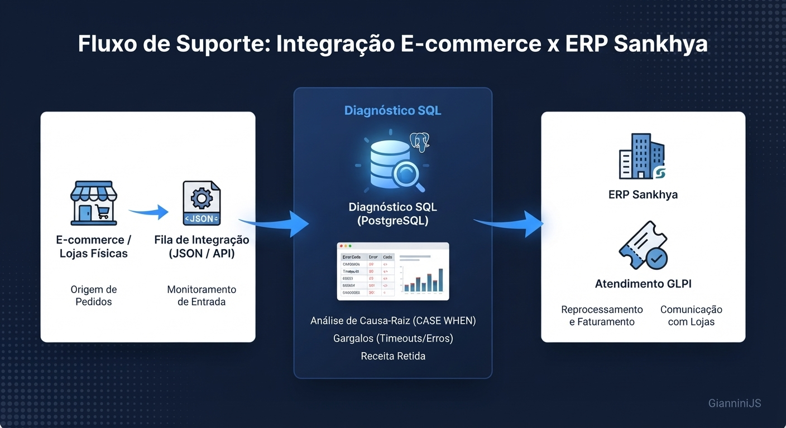
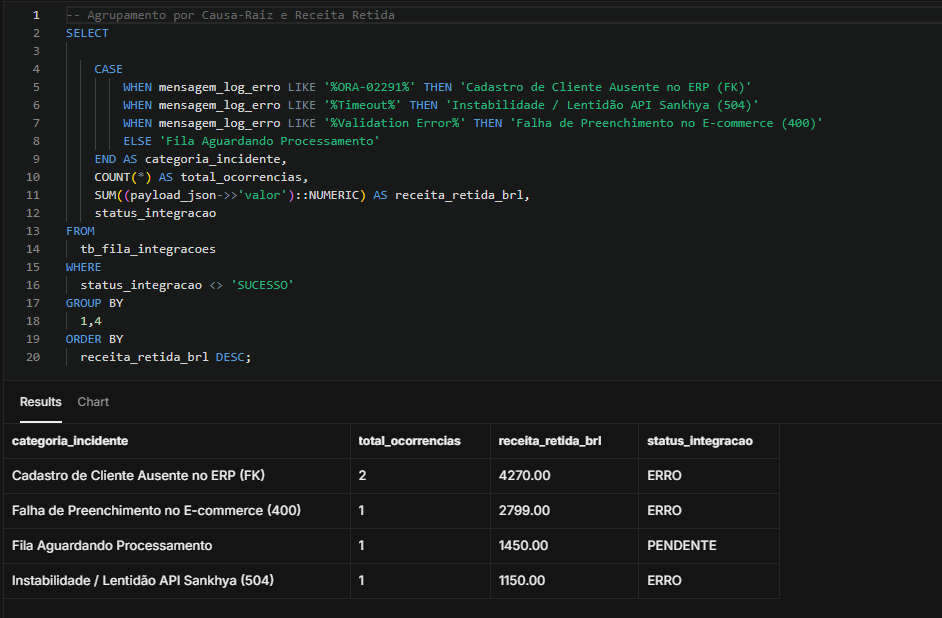
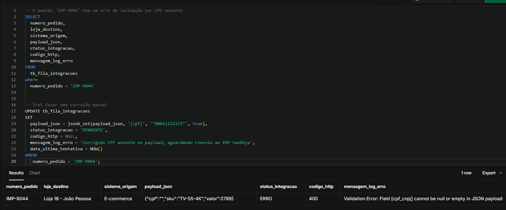
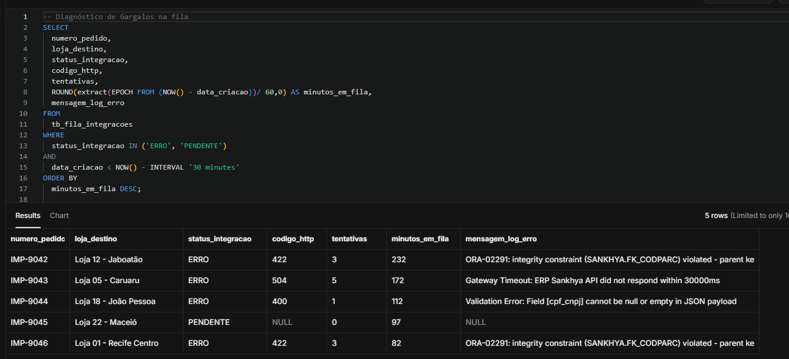
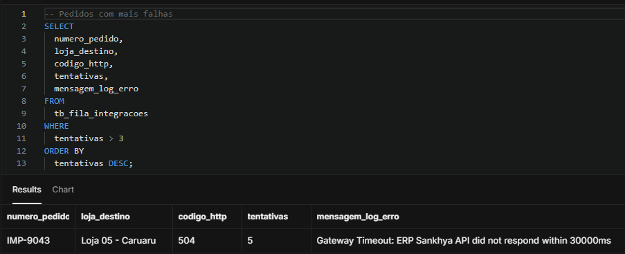
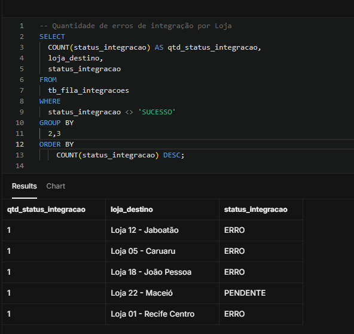

# Monitoramento e Diagnóstico de Integrações E-commerce x ERP (Simulação Império Móveis e Eletro)

Projeto prático de **Suporte de Sistemas e Análise de Dados** desenvolvido para simular a rotina de sustentação de integrações entre o **E-commerce** e o **ERP Sankhya** em uma operação de varejo de móveis e eletrodomésticos com múltiplas lojas no Nordeste.

---

## Contexto e Problema de Negócio

Em operações de varejo omnichannel, pedidos realizados no e-commerce precisam ser integrados rapidamente ao ERP para faturamento, separação em estoque e emissão de nota fiscal. Quando ocorre uma falha na fila de integração (erro de validação no JSON, cadastro de cliente ausente no ERP ou instabilidade de API), o pedido fica retido, gerando:
* Atraso na entrega ao cliente final;
* Receita represada aguardando faturamento;
* Abertura de chamados pelas lojas físicas no sistema de atendimento (**GLPI**).

**Objetivo deste projeto:** Demonstrar como diagnosticar gargalos via **SQL (PostgreSQL)**, inspecionar payloads **JSONB**, quantificar o impacto financeiro dos incidentes e padronizar a resposta ao usuário final.

---

## Estrutura do Repositório

* [`01_criar_tabela_e_dados.sql`](./01_criar_tabela_e_dados.sql) — Script DDL/DML para criação da tabela `tb_fila_integracoes` e carga de dados simulando cenários reais de sucesso, pendência e erro.
* [`02_queries_diagnostico.sql`](./02_queries_diagnostico.sql) — Consultas SQL para levantamento de gargalos por tempo, agrupamento de causa-raiz, receita retida, auditoria de campos `JSONB`, visão por loja e simulação de saneamento (`UPDATE`).
* [`03_guia_atendimento_glpi.md`](./03_guia_atendimento_glpi.md) — Padrão de comunicação técnica traduzida para a linguagem de negócio no atendimento de chamados das lojas.
* [`prints/`](./prints/) — Diagrama de arquitetura e evidências das consultas executadas no banco de dados PostgreSQL (Supabase).

---

## Principais Análises e Evidências (PostgreSQL / Supabase)

### 1. Mapeamento de Causa-Raiz e Receita Retida (`CASE WHEN` + `JSONB`)
Utilizando `CASE WHEN` sobre os logs de erro (`ORA-02291`, `Gateway Timeout 504`, `Validation Error 400`) e extração direta da chave `valor` dentro da coluna `payload_json`, foi possível priorizar os incidentes pelo impacto financeiro:
* **Cadastro de Cliente Ausente no ERP (FK):** principal fator de retenção de receita, exigindo sincronização cadastral antes do reprocessamento.
* **Falha de Preenchimento no E-commerce (HTTP 400):** pedido enviado com `cpf` vazio no JSON, corrigido via saneamento controlado antes do reenvio.
* **Instabilidade / Lentidão de API (HTTP 504):** pedidos com múltiplas tentativas falhas exigindo monitoramento de fila.

---

### 2. Saneamento Manual de Payload (`UPDATE` no CPF antes do reenvio)
Após identificar o erro de validação no pedido `IMP-9044` (campo `cpf` vazio no JSON), foi executado um saneamento controlado no registro para deixá-lo apto ao reprocessamento seguro no ERP Sankhya.

---

### 3. Diagnóstico de Gargalos na Fila (> 30 minutos)
Consulta focada em SLA para identificar pedidos parados na fila além do tempo esperado, priorizando a atuação do suporte antes de gerar reclamações nas lojas ou atraso na expedição.

---

### 4. Pedidos com Maior Número de Tentativas Falhas
Monitoramento de registros que acumulam múltiplas tentativas de envio sem sucesso, prevenindo loops de reprocessamento e sobrecarga na API de integração.

---

### 5. Volume de Ocorrências por Loja de Destino
Distribuição das falhas e pendências por filial para atuação proativa do suporte junto às lojas físicas e alinhamento com as equipes locais.

---

## Fluxo de Atendimento (GLPI)

Além da investigação no banco de dados, o projeto contempla a etapa de **comunicação com o usuário** (disponível em [`03_guia_atendimento_glpi.md`](./03_guia_atendimento_glpi.md)), garantindo que o colaborador da loja receba:
1. Diagnóstico claro sem jargões técnicos excessivos;
2. Confirmação da ação corretiva realizada;
3. Status atualizado do pedido para faturamento.

---

## Tecnologias Utilizadas

* **Banco de Dados:** PostgreSQL (hospedado no Supabase)
* **Linguagem:** SQL (manipulação de `JSONB`, funções de data/hora, agregações condicionais e `CASE WHEN`)
* **Processos de Suporte:** Análise de APIs REST / HTTP Status Codes (`200`, `400`, `422`, `504`), leitura de logs Oracle/Sankhya e padronização de chamados GLPI

---

**Autor:** Giannini J. da Silva  
*Graduando em Ciência de Dados | Suporte de Sistemas & Análise de Dados*
🔗 [LinkedIn](https://www.linkedin.com/in/giannini-j-da-silva-56bb9a16b)

